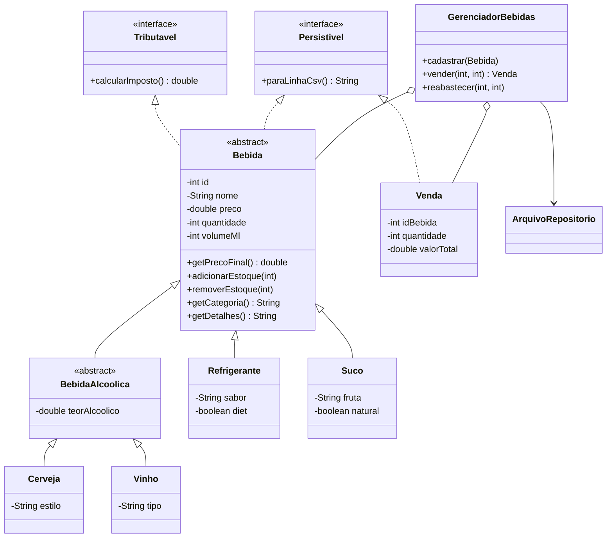

# Sistema de Gerenciamento de Bebidas

Projeto em **Java puro** (sem Spring Boot, sem Maven/Gradle, sem bibliotecas externas) feito para a disciplina de Programação Orientada a Objetos. É um sistema de console para controlar o estoque e as vendas de uma loja de bebidas.

## Como executar

Requisito: JDK 11 ou superior instalado (`java -version` e `javac -version` devem funcionar).

Em uma IDE (IntelliJ, Eclipse, VS Code), marque a pasta `src` como raiz dos fontes e execute a classe `app.Main`.

Pelo terminal, a partir da pasta do projeto:

```powershell
javac -encoding UTF-8 -d out -sourcepath src src\app\Main.java
java -Dfile.encoding=UTF-8 -Dstdout.encoding=UTF-8 -cp out app.Main
```

Se os acentos aparecerem errados no Windows, rode `chcp 65001` antes. Para compilar e rodar os testes automáticos, use `testar.bat`.

Na primeira execução o sistema cria a pasta `dados/` com 9 bebidas de exemplo. Tudo o que você cadastrar, vender ou reabastecer é salvo automaticamente nos arquivos `dados/bebidas.csv` e `dados/vendas.csv`. Para recomeçar do zero, apague a pasta `dados/`.

## Funcionalidades (menu)

1. Cadastrar bebida (cerveja, vinho, refrigerante ou suco)
2. Listar bebidas (ordenadas por nome)
3. Buscar bebida por nome
4. Reabastecer estoque
5. Registrar venda (pergunta a idade do cliente se a bebida for alcoólica)
6. Remover bebida
7. Relatório do estoque (valor, imposto embutido, estoque baixo, total vendido)
8. Histórico de vendas

## Estrutura

```
src/
  app/          Main (menu) e Entrada (leitura segura do teclado)
  modelo/       Bebida, BebidaAlcoolica, Cerveja, Vinho, Refrigerante, Suco, Venda,
                interfaces Tributavel e Persistivel
  servico/      GerenciadorBebidas (regras do sistema) e DadosExemplo
  persistencia/ ArquivoRepositorio (lê/grava CSV) e BebidaFactory
  excecoes/     GestaoBebidasException e as exceções específicas
  teste/        TestesBasicos (testes automáticos em Java puro)
```

## Onde cada conteúdo da disciplina aparece

| Conteúdo | Onde ver |
|---|---|
| Criação de classes, atributos privados, construtores, getters/setters (encapsulamento) | `modelo/Bebida.java` |
| Herança e reuso de código | `Bebida` → `BebidaAlcoolica` → `Cerveja` / `Vinho`; `Bebida` → `Refrigerante` / `Suco` |
| Classes abstratas | `Bebida` e `BebidaAlcoolica` (métodos abstratos: `getCategoria`, `getDetalhes`, `camposEspecificos`) |
| Interfaces | `Tributavel`, `Persistivel` (e `Comparable` do próprio Java) |
| Polimorfismo | `GerenciadorBebidas.calcularImpostoTotalEstoque()`, `Main.listarBebidas()`, `ArquivoRepositorio.salvar()` |
| Coleções (`ArrayList`) | `GerenciadorBebidas` (listas de bebidas e de vendas) |
| `for-each` | `GerenciadorBebidas`, `Main`, `ArquivoRepositorio` |
| Ordenação com `Collections.sort` + `compareTo` | `GerenciadorBebidas.listarOrdenadas()` |
| `try / catch` e exceções próprias | `excecoes/`, `Main.executarMenu()`, `Entrada` |
| `throws` e hierarquia de exceções | `Bebida.removerEstoque()`, `GestaoBebidasException` como classe-mãe |
| Composição / separação de responsabilidades | `GerenciadorBebidas` "tem" bebidas, vendas e um repositório; `Main` só faz a interface com o usuário |
| Persistência em arquivos (`try-with-resources`) | `persistencia/ArquivoRepositorio.java` |
| Strings (`split`, `format`, `equalsIgnoreCase`...) | `BebidaFactory`, `Bebida.toString()` |
| Testes automáticos | `teste/TestesBasicos.java` |

## Diagrama de classes (UML)



## Regras de imposto (exemplo de polimorfismo)

Cada tipo de bebida calcula o imposto do seu jeito, mas o resto do sistema só chama `calcularImposto()`:

| Tipo | Alíquota |
|---|---|
| Cerveja | 25% |
| Vinho | 30% |
| Refrigerante | 20% (15% se for diet/zero) |
| Suco | 10% (5% se for 100% natural) |

## Formato dos arquivos

`dados/bebidas.csv` (uma bebida por linha, campos separados por `;`):

```
CERVEJA;1;Skol Pilsen;4.5;45;350;4.7;Pilsen
REFRIGERANTE;7;Guaraná Zero;7.2;30;2000;Guaraná;true
```

`dados/vendas.csv`:

```
1;Skol Pilsen;3;16.875;2026-11-22T08:34:43
```

Linhas inválidas (editadas à mão, por exemplo) são ignoradas com um aviso, sem derrubar o programa.

## Testes

`testar.bat` roda 36 verificações: impostos por tipo, validação de dados, estoque insuficiente, conversão para/de CSV, vendas, busca e gravação/leitura de arquivo. Os testes foram escritos sem JUnit para que o projeto continue sem dependências; se quiser migrar, cada método `testarXxx` vira um `@Test` com `assertEquals` / `assertThrows`.
