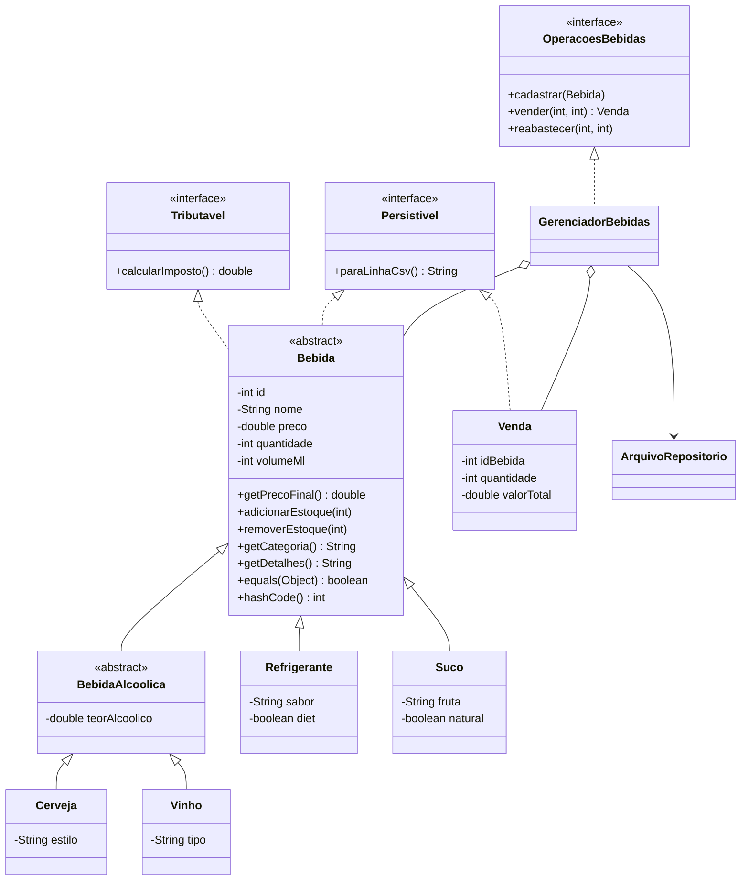

# Sistema de Gerenciamento de Bebidas

Projeto da disciplina **Linguagem de Programação**, feito em **Java puro** (sem Spring Boot e sem frameworks) e com build gerenciado pelo **Maven**. É um sistema de console para controlar o estoque e as vendas de uma loja de bebidas.

Alunos: Sérgio Guilherme, Josué Francisco, José Lucas.


## Como executar

Requisitos: JDK 17 ou superior e Maven (`java -version` e `mvn -version` devem funcionar). A IntelliJ já traz o Maven embutido: abra a pasta como projeto Maven (se perguntar, clique em *Load Maven Project*) e use a aba **Maven** à direita ou execute a classe `app.Main`.

Pelo terminal, a partir da pasta do projeto:

| Ação | Comando |
|---|---|
| Rodar os testes (JUnit 5) | `mvn test` |
| Compilar e rodar o sistema | `mvn compile exec:java` |
| Gerar o jar executável | `mvn package` |
| Rodar o jar gerado | `java -jar target\gestao-de-bebidas-1.0.jar` |

Se os acentos aparecerem errados no Windows, rode `chcp 65001` antes.

Na primeira execução o sistema cria a pasta `dados/` com 9 bebidas de exemplo. Tudo o que você cadastrar, vender ou reabastecer é salvo automaticamente nos arquivos `dados/bebidas.csv` e `dados/vendas.csv`. Para recomeçar do zero, apague a pasta `dados/`.

## Funcionalidades (menu)

1. Cadastrar bebida (cerveja, vinho, refrigerante ou suco)
2. Listar bebidas (ordenadas por nome)
3. Buscar bebida por nome
4. Reabastecer estoque
5. Registrar venda (pergunta a idade do cliente se a bebida for alcoólica)
6. Remover bebida
7. Relatório do estoque (valor, imposto embutido, estoque baixo, total vendido)
8. Histórico de vendas
9. Salvar dados
0. Salvar e sair

## Requisitos do mini-projeto

| Req. | O que pede | Como o projeto atende |
|---|---|---|
| 1 | Classe de entidade com `hashCode` e `equals` | `modelo/Bebida.java`: `equals`/`hashCode` comparam **nome (sem diferenciar maiúsculas) + volume**. São usados em `GerenciadorBebidas.cadastrar()` (via `indexOf`) para impedir bebida duplicada |
| 2 | Interface com as operações principais e classe concreta que guarda os dados em `ArrayList`/`LinkedList` | Interface `servico/OperacoesBebidas.java`; implementação `servico/GerenciadorBebidas.java`, que guarda bebidas e vendas em `ArrayList` |
| 3 | Exceção própria (herda de `Exception`), lançada com `throws` na interface e na classe, e tratada com `try/catch` no menu | `excecoes/` (`GestaoBebidasException` e as filhas); `throws` em `OperacoesBebidas` e `GerenciadorBebidas` (ex.: `vender`, `buscarPorId`, `cadastrar`); `try/catch` em `Main.executarMenu()` |
| 4 | Persistir em arquivo texto editável, com `BufferedReader`/`BufferedWriter` | `persistencia/ArquivoRepositorio.java`. Lê no início (`Main.carregarDados()`) e grava ao sair (opção 0), na opção 9 e depois de cada alteração. Arquivos: `dados/bebidas.csv` e `dados/vendas.csv` |
| 5 | Menu com ao menos 6 operações (cadastrar, pesquisar, salvar dados, sair...) | `app/Main.java`: menu de texto com 8 operações, mais *Salvar dados* e *Salvar e sair*, todas ligadas aos métodos da interface |
| 6 (opcional) | Classe herdada por outras, abstrata ou não | `Bebida` e `BebidaAlcoolica` (abstratas) → `Cerveja`, `Vinho`, `Refrigerante`, `Suco` |

## Estrutura (padrão Maven)

```
pom.xml                          configuração do Maven (Java 17, JUnit 5, jar executável)
src/main/java/
  app/          Main (menu) e Entrada (leitura segura do teclado)
  modelo/       Bebida, BebidaAlcoolica, Cerveja, Vinho, Refrigerante, Suco, Venda,
                interfaces Tributavel e Persistivel
  servico/      OperacoesBebidas (interface), GerenciadorBebidas (implementação) e DadosExemplo
  persistencia/ ArquivoRepositorio (lê/grava CSV) e BebidaFactory
  excecoes/     GestaoBebidasException e as exceções específicas
src/test/java/
  modelo/ servico/ persistencia/   testes automáticos com JUnit 5
```

A única dependência do projeto é o JUnit 5, usado apenas nos testes (`scope` `test`). O sistema em si usa somente a biblioteca padrão do Java.

## Onde cada conteúdo da disciplina aparece

| Conteúdo | Onde ver |
|---|---|
| Criação de classes, atributos privados, construtores, getters/setters (encapsulamento) | `modelo/Bebida.java` |
| Herança e reuso de código | `Bebida` → `BebidaAlcoolica` → `Cerveja` / `Vinho`; `Bebida` → `Refrigerante` / `Suco` |
| Classes abstratas | `Bebida` e `BebidaAlcoolica` (métodos abstratos: `getCategoria`, `getDetalhes`, `camposEspecificos`) |
| Interfaces | `OperacoesBebidas`, `Tributavel`, `Persistivel` (e `Comparable` do próprio Java) |
| `equals` e `hashCode` | `modelo/Bebida.java` |
| Polimorfismo | `GerenciadorBebidas.calcularImpostoTotalEstoque()`, `Main.listarBebidas()`, `ArquivoRepositorio.salvar()` |
| Coleções (`ArrayList`) | `GerenciadorBebidas` (listas de bebidas e de vendas) |
| `for-each` | `GerenciadorBebidas`, `Main`, `ArquivoRepositorio` |
| Ordenação com `Collections.sort` + `compareTo` | `GerenciadorBebidas.listarOrdenadas()` |
| `try / catch` e exceções próprias | `excecoes/`, `Main.executarMenu()`, `Entrada` |
| `throws` e hierarquia de exceções | `Bebida.removerEstoque()`, `GestaoBebidasException` como classe-mãe |
| Composição / separação de responsabilidades | `GerenciadorBebidas` "tem" bebidas, vendas e um repositório; `Main` só faz a interface com o usuário |
| Persistência em arquivos (`try-with-resources`) | `persistencia/ArquivoRepositorio.java` |
| Strings (`split`, `format`, `equalsIgnoreCase`...) | `BebidaFactory`, `Bebida.toString()` |
| Testes automáticos com JUnit | `src/test/java/` (34 testes) |
| Maven | `pom.xml` |

## Diagrama de classes (UML)



## Regras de imposto (exemplo de polimorfismo)

Cada tipo de bebida calcula o imposto do seu jeito, mas o resto do sistema só chama `calcularImposto()`:

| Tipo | Alíquota |
|---|---|
| Cerveja | 25% |
| Vinho | 30% |
| Refrigerante | 20% (15% se for diet/zero) |
| Suco | 10% (5% se for 100% natural) |

## Formato dos arquivos

`dados/bebidas.csv` (uma bebida por linha, campos separados por `;`):

```
CERVEJA;1;Skol Pilsen;4.5;45;350;4.7;Pilsen
REFRIGERANTE;7;Guaraná Zero;7.2;30;2000;Guaraná;true
```

`dados/vendas.csv`:

```
1;Skol Pilsen;3;16.875;2026-11-22T08:34:43
```

Linhas inválidas (editadas à mão, por exemplo) são ignoradas com um aviso, sem derrubar o programa.

## Testes

`mvn test` roda 34 testes JUnit 5:

| Classe de teste | O que verifica |
|---|---|
| `modelo/BebidaTest` | impostos por tipo (polimorfismo), validação de dados, regras de estoque, `equals`/`hashCode` |
| `persistencia/BebidaFactoryTest` | conversão de linha CSV em objeto e vice-versa, linhas inválidas |
| `persistencia/ArquivoRepositorioTest` | gravar e recarregar arquivos, linha corrompida, pasta inexistente |
| `servico/GerenciadorBebidasTest` | vendas, duplicidade, buscas, relatórios, remoção |
